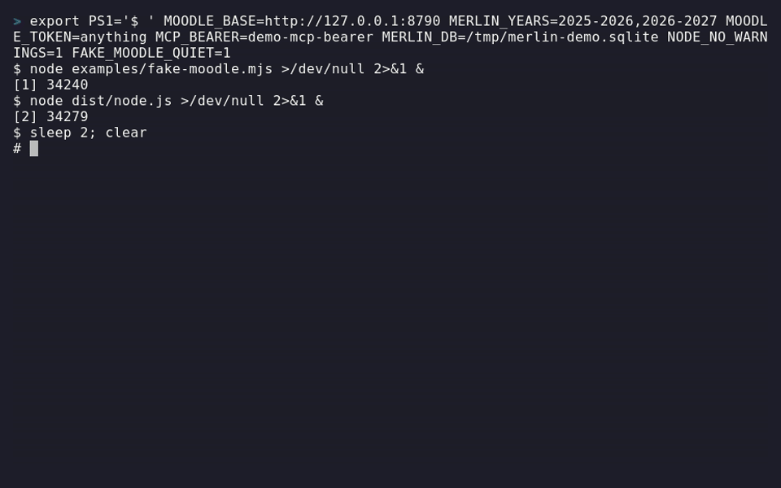
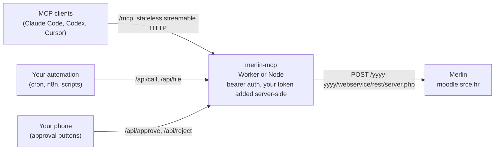

# Merlin MCP

[](https://github.com/simonseifert/merlin-mcp/actions/workflows/ci.yml) [](LICENSE) [](https://modelcontextprotocol.io)

**TL;DR:** A read-only bridge from your own [Merlin](https://moodle.srce.hr) account (SRCE's Moodle for Croatian universities, Moodle 5.2) to AI agents over the [Model Context Protocol](https://modelcontextprotocol.io). It runs as a Cloudflare Worker or self-hosted on Node or Docker, from the same code. It serves MCP on `/mcp` and a few bearer-gated REST routes for automation. It never writes to Merlin, with one optional, gated exception: private messages, which go out only after you tap **Send** on your phone. Two reads leave the same traces a browser would: opening a forum thread marks it read, and asking `moodle_get_assignments` for feedback logs a "feedback viewed" event your teachers can see (off by default). One server holds one person's token; don't host other people's.

> Unofficial. Not affiliated with or endorsed by SRCE or any university. Use it only with your own account, follow your institution's rules (AAI@EduHr included), and keep the call volume low. See [SECURITY.md](SECURITY.md) for the security model.



*Recorded against a fake Merlin with invented data. Try it yourself in a few commands: [examples/](examples/README.md).*

## What it does



- **Every active academic year at once.** Merlin runs one Moodle site per academic year (`https://moodle.srce.hr/<start>-<end>`), each with its own database, so ids are only unique within a year. The server reads the current year (rolls over on 1 October, Europe/Zagreb) plus the previous one, plus next year from 1 September once its site answers. `MERLIN_YEARS="2025-2026,2026-2027"` overrides the list and `MOODLE_URL` pins one year.
- **Polite by design.** An honest `User-Agent` (add your contact with `MOODLE_CONTACT`), the token in a POST body rather than the URL, at most 120 Moodle calls a minute per server process (file downloads included), and a pause for `Retry-After` when Merlin answers 429 or 503.
- **Code layout:** `src/app.ts` is the platform-neutral core (routes, auth, MCP tools, Moodle client). `src/index.ts` is the Cloudflare entry, `src/node.ts` the Node entry (HTTP or stdio), `src/approvals.ts` the pending-send store, `src/lib.ts` the pure helpers (years, auth compare, the allow-list, redaction, HTML stripping). Tests are in `test/`, an agent skill in `skills/merlin/`, client snippets in [CLIENTS.md](CLIENTS.md).

## MCP tools

All tools except `moodle_send_message` are read-only, and all take an optional `year` (see "Multiple years"). Output is compact JSON: HTML stripped, noise fields dropped, a Zagreb-local string (`*_local`) next to every timestamp. Results are capped at 200k characters by dropping whole trailing items, so the output is always valid JSON; a capped result says `truncated: true` and gives `omitted_items`.

| Tool | Moodle function(s) | What it's for |
|---|---|---|
| `moodle_whoami` | core_webservice_get_site_info | token sanity check |
| `moodle_get_courses` | core_enrol_get_users_courses | enrolled courses |
| `moodle_get_notifications` | message_popup_get_popup_notifications | bell-icon notifications |
| `moodle_get_calendar_events` | core_calendar_get_calendar_events | sessions, deadlines and exams in a window |
| `moodle_get_upcoming_deadlines` | core_calendar_get_action_events_by_timesort | action-required items, sorted by due time |
| `moodle_get_course_contents` | core_course_get_contents | sections and modules of one course |
| `moodle_list_files` | core_course_get_contents | every file with size, modified time and a ready `/api/file?url=…` path |
| `moodle_get_updates_since` | core_course_get_updates_since | cheap "what changed in the last N hours" |
| `moodle_get_recent_forum_posts` | mod_forum_get_forum_discussions | latest discussions in a forum |
| `moodle_get_forum_discussion` | mod_forum_get_discussion_posts | full text of one thread (marks it read, like a browser) |
| `moodle_get_grades` | gradereport_user_get_grade_items | grades and feedback, for one course or all |
| `moodle_get_assignments` | mod_assign_get_assignments (+ mod_assign_get_submission_status with `include_feedback`) | due dates; with `include_feedback=true` also submission status and grader comments, which logs a teacher-visible "feedback viewed" event |
| `moodle_get_quiz_attempts` | mod_quiz_get_user_attempts | your attempts at a quiz |
| `moodle_get_quiz_attempt_review` | mod_quiz_get_attempt_review | per-question marks and feedback of a finished attempt |
| `moodle_get_messages` | core_message_get_conversations / core_message_get_conversation_messages | private-message inbox, or one full thread |
| `moodle_send_message` | core_message_send_instant_messages, only after phone approval | **write, gated, optional**: creates a pending DM and returns `pending_approval`; nothing is sent until you tap Send. Offered only when `RELAY_BEARER` is set |

## Sending a message (phone approval)

The model can only *request* a send. It never receives the approval key, and no bearer-authenticated route can send. Merlin tells you through a built-in notifier; you approve with one tap.

```
agent ─► moodle_send_message ─► pending send (random id + 192-bit key, 30 min expiry); the agent gets "pending_approval", never the key
server ─► your notifier (ntfy or webhook) ─► recipient + full text, with [Send] [Reject]
your phone ─► POST /api/approve/<id>?k=<key>  ─► the server sends exactly the stored text
           └► POST /api/reject/<id>?k=<key>   ─► marked rejected, nothing sent
```

**ntfy (two lines).** Install the [ntfy](https://ntfy.sh) app, subscribe to a long random topic, and set:

```
NOTIFY_NTFY_URL=https://ntfy.sh/<your-long-random-topic>
NOTIFY_NTFY_TOKEN=...        # optional, for a protected or self-hosted server
```

The notification shows the recipient and the full text with **Send** and **Reject** buttons that `POST` straight from the app.

**Discord (or any webhook).**

```
NOTIFY_WEBHOOK_URL=https://discord.com/api/webhooks/...
NOTIFY_WEBHOOK_FORMAT=discord   # or "json" (the default) for n8n, Home Assistant, Make, your own script
```

Webhook links cannot `POST`, so they open a **confirm page** (`GET /api/approve/<id>?k=<key>`) that shows the recipient, year, full text and expiry with one button. A `GET` never changes anything, so link previews and prefetchers are harmless. `json` posts `{event, id, year, to, text, approve_url, reject_url, expires_at}`; a short `send_outcome` event follows after you approve (sent, failed, or unclear).

On Workers set these as `wrangler secret put` (they contain secrets: the topic and webhook URL are credentials). On Node/Docker put them in `merlin.env`; behind a proxy also set `MERLIN_PUBLIC_URL` so the links point at your public address.

- **Your own relay still works.** Anything that polls `GET /api/pending` with `RELAY_BEARER` and shows two buttons that `POST` is supported exactly as before. The send tool is offered when `RELAY_BEARER` **or** a notifier is configured; with neither, nobody could approve, so it is left out. `MERLIN_ENABLE_SEND=0` also turns it off.
- **What the channel sees.** The notification carries the full message text and the approval links (the key is in the link). Whoever can read the topic or webhook can approve, so use a long random topic or a protected server, not a shared channel. Notification errors are logged without URLs, time out after 5 s, and never fail the request.
- **Limits.** Recipients must be people you already have a Merlin conversation with. Plain text, at most 1800 characters. At most 10 sends per Zagreb day (a failed send gives its slot back) and 5 undecided requests at once. Each link works once, needs `POST` to act, and expires after 30 minutes.
- **Why.** Merlin messages and forum posts are untrusted input. A prompt injection in one of them must not be able to make the agent send anything.

## Multiple years

- **List tools** (`moodle_get_notifications`, `moodle_get_calendar_events`, `moodle_get_upcoming_deadlines`, `moodle_get_courses`, `moodle_get_messages`, `moodle_get_grades`, `moodle_get_assignments`, `moodle_whoami`) default to `year="all"`: every active year in parallel, returning `{years, items, errors?}` with `year` on every item. One failing year goes under `errors` and the others still come back.
- **Id tools** (`moodle_get_course_contents`, `moodle_list_files`, `moodle_get_updates_since`, `moodle_get_recent_forum_posts`, `moodle_get_quiz_attempts`, `moodle_get_quiz_attempt_review`, `moodle_get_forum_discussion`) take the id's `year`, or find it themselves. An id that exists in more than one year returns an error asking for `year`.
- **Copies from the yearly clone.** Each new year's site starts as a copy of the last, so older notifications and messages exist in both. Copies are collapsed on (id + time + subject) or (id + members), never on id alone, and the kept copy lists the other years in `also_in`.
- **Tokens.** One token usually works on both sites because the clone copies it. If they ever differ, set `MOODLE_TOKENS` to a JSON map `{"2025-2026": "...", "2026-2027": "..."}`; a missing year falls back to `MOODLE_TOKEN`.

## REST endpoints

`/api/*` takes `Authorization: Bearer <API_BEARER>`. `/mcp` takes `MCP_BEARER`. Neither opens the other (unless you set `LEGACY_API_BEARER="1"` for an old single-bearer setup). The approval routes have their own credentials.

- `GET /api/call?wsfunction=<fn>[&year=]&<params>`: a read-only passthrough for an exact, reviewed list of 19 functions (`API_CALL_ALLOWLIST` in `src/lib.ts`). Anything else is a 400 and never reaches Moodle. Callers can't override the token or format, `core_message_get_messages` always has `markasread=0`, and credential fields (including keys embedded in `tokenpluginfile.php` URLs) are stripped from responses.
- `GET /api/notifications?unread_only=true&limit=20[&year=]`: a JSON array of raw notification objects. `year=all` merges every active year.
- `GET /api/file?url=<https://moodle.srce.hr/...>`: a file proxy. The token is added server-side; redirects are refused, not followed.
- `GET /api/pending` (`RELAY_BEARER` only): the last 24 h of send requests with `approve_url` / `reject_url` while pending.
- `GET /api/approve/<id>?k=<key>`, `GET /api/reject/<id>?k=<key>`: no bearer. An HTML confirm page with one `POST` button; changes nothing. 404 for an unknown id or wrong key.
- `POST /api/approve/<id>?k=<key>`, `POST /api/reject/<id>?k=<key>`: no bearer. 200 with what happened, or 404, 409, 410, 429. These and `/api/pending` send `Cache-Control: no-store` and `Referrer-Policy: no-referrer`; the confirm page also sets a strict `Content-Security-Policy` and `X-Frame-Options: DENY`.

## Getting your token

The server needs a Moodle web-service token for your account. On Merlin you sign in through AAI@EduHr, so `login/token.php` with a password doesn't work. Use the mobile-app sign-in that Moodle documents (`admin/tool/mobile/launch.php`, [source](https://github.com/moodle/moodle/blob/v5.2.2/public/admin/tool/mobile/launch.php)), the same flow the MerlinMobile app uses. You sign in yourself, in your own browser; nothing here sees your AAI password.

1. **Make the link.** `node scripts/get-token.mjs link --year 2026-2027` (use the academic year you need). It prints a `launch.php` link.
2. **Open it and sign in.** In Firefox, open DevTools first (F12, Network tab, tick "Persist logs"); in Chrome, tick "Preserve log". Open the link and sign in with AAI@EduHr if asked.
3. **Copy the answer.** At the end Moodle redirects to an address starting `merlin-token://token=` (it may use another name, such as `moodlemobile://`, if the site forces one). The browser can't open it: Firefox shows it in an error page, otherwise find the `launch.php` request in the Network tab and copy its `Location` header.
4. **Save it.** `node scripts/get-token.mjs save '<that whole address>' --year 2026-2027`. It checks the answer matches your link and writes `MOODLE_TOKEN` into `merlin.env` (readable only by you, and gitignored). It never prints the token unless you add `--print`, and it drops the second "private token" Moodle sends along.
5. **Check it.** Start the server and call `moodle_whoami`: it should show your name for every year you use.

| Problem | What to do |
|---|---|
| No `...token=` address appears anywhere | Log in to Merlin in that browser first, then open the link again in the same browser. |
| "Warning: this answer does not match the last link" | You copied an answer from an older link or another year. Make a new link and repeat. |
| `invalidtoken` later | The token expired or was reset. Repeat these steps. |
| Works for one year only | Make a token per year and set `MOODLE_TOKENS` (see "Multiple years"). |

Things to know:

- **It's the same token the official app uses.** Moodle hands back your existing token, so every client shares one. If it's ever reset, all of them stop working at once.
- **Treat it like a password.** Students usually can't revoke their own token on Merlin, so a leaked one stays valid until it expires or SRCE revokes it. Never commit it, paste it in chats, or put it in a shared server.
- **It expires.** Moodle's default lifetime is 12 weeks (sites can change it). An `invalidtoken` error means you need a fresh one.

## Run it

**Cloudflare Worker**

```bash
npm install
npm run typecheck && npm test
npx wrangler secret put MOODLE_TOKEN      # and MCP_BEARER, API_BEARER; optionally RELAY_BEARER, MOODLE_CONTACT, MOODLE_TOKENS
npx wrangler deploy
```

Make bearers with `openssl rand -hex 32`. `npm run dev` runs it locally from a gitignored `.dev.vars`.

**Node or Docker** (needs Node 22.13+). Configuration is environment variables with the same names (`merlin.env.example`). Pending sends live in SQLite (`MERLIN_DB`, default `./merlin.sqlite`).

```bash
npm ci && npm run build:node
MOODLE_TOKEN=... MCP_BEARER=... API_BEARER=... node dist/node.js   # HTTP on :8787
MOODLE_TOKEN=... node dist/node.js --stdio                          # one local client, read-only

docker build -t merlin-mcp .
docker run --env-file merlin.env -p 8787:8787 -v merlin-data:/data merlin-mcp
```

- **stdio is always read-only:** it never offers `moodle_send_message` and creates no database file.
- **Listening address:** the Node server listens on `127.0.0.1` only unless you set `HOST` (the Docker image sets `HOST=0.0.0.0`). `GET /healthz` answers without auth and without calling Moodle, for health checks.
- **Reachability:** a server on your LAN or tailnet works for CLI agents. claude.ai and ChatGPT connect from their own clouds and need a public HTTPS URL plus OAuth, which this server doesn't have yet. Behind a reverse proxy, set `MERLIN_PUBLIC_URL` so approval links use the public address.

After a deploy, check: `moodle_whoami` answers for each year, `tools/list` returns the tools, and `/api/call?wsfunction=core_webservice_get_site_info` works with the API bearer and fails (401) with the MCP bearer.

## Connecting a client

Snippets for Claude Code, Codex, Gemini CLI, Cursor, Hermes, OpenClaw, n8n and stdio are in [CLIENTS.md](CLIENTS.md). Load the agent skill in [skills/merlin/](skills/merlin/SKILL.md) alongside, so the agent knows which tool answers what and the safety rules.

For Claude Code, keep the bearer out of `~/.claude.json` with a `headersHelper` that reads it from a mode-600 file:

```json
"merlin": {
  "type": "http",
  "url": "https://<your-worker>.workers.dev/mcp",
  "headersHelper": "/path/to/print-merlin-header.sh"
}
```

where the script prints `{"Authorization": "Bearer <MCP_BEARER>"}`.

## Notes

- If Merlin's admins disable a function, the tool that uses it returns an error.
- Moodle errors come back as tool errors or 502s, with the token redacted.
- `wrangler.toml` declares an empty `MerlinMCP` Durable Object class. It is unused (left over from before 0.4) and will be removed with a `deleted_classes` migration.

## Licence

[MIT](LICENSE)
